# Guía de uso y validación de AutoAudit

**Documento histórico de la fase SQL del 25/10/2026. La guía vigente de la interfaz integrada es [GUIA_INTERFAZ.md](GUIA_INTERFAZ.md), también disponible en Word y PDF.**

Esta guía resume el uso SQL comprobado y las capturas aportadas de la interfaz. Las imágenes `01`–`11` corresponden a Adminer 6.2 usado como cliente SQL temporal local. Adminer no es la GUI del proyecto. Las imágenes `12` y `13` son capturas aportadas de la interfaz AutoAudit; muestran el panel y la configuración, pero no prueban que la pantalla Consulta esté conectada a esta base.

## 1. Instalación reproducible

En una base nueva de un clúster de pruebas, ejecutar en este orden: `sql/01_estructura_autoaudit.sql`, `sql/03_generador_triggers.sql`, `sql/05_consultas_historial.sql`, `sql/06_seguridad.sql` y `sql/07_pruebas_rendimiento.sql`. Para repetir las capturas, cargar aparte las partes A y B de `sql/08_datos_demostracion.sql`, hasta el marcador FIN PARTE B. La parte C contiene demostraciones adicionales, errores esperados y llamadas de rendimiento; no se ejecutó completa para estas capturas.

Requisitos: PostgreSQL 18, un cliente SQL y un clúster dedicado a pruebas. La validación realizada utilizó PostgreSQL 18.6 sobre Ubuntu 26.04.1 en Docker/WSL2. El nombre de la base del ejecutor debe ser `autoaudit_test` o `autoaudit_test_<sufijo>` y el esquema `auditoria` aún no debe existir. El ejecutor rechaza una base previamente instalada.

En DBeaver, crear una conexión a la base nueva, abrir cada archivo indicado en el editor de esa conexión y ejecutarlo como script con Alt+X. Los archivos `02` y `04` contienen consultas de diccionario y ejemplos manuales: no son requisitos adicionales de instalación del ejecutor. `02` utiliza parámetros que deben completarse en el cliente. Las llamadas de ejemplo de `07`, incluida la de 100.000, permanecen comentadas.

Los roles de grupo `aud_admin` y `aud_consulta` se crean sin LOGIN. Los usuarios reales deben recibir el rol que corresponda. En el laboratorio de capturas se habilitó LOGIN para las cuentas ficticias de la demostración con credenciales temporales; ese ajuste se limitó al clúster desechable. No se incluyen contraseñas en la documentación.

Desde una terminal con Python y `psql` disponibles, el ejecutor instala las fuentes y verifica los resultados en una base nueva:

```bash
python tests/run_tests.py --database autoaudit_test --confirmar-cluster-aislado
```

La ejecución backend controlada del 26/10/2026 produjo 240 PASS, 0 FAIL y 0 BLOCKED. La evidencia actual está en `tests/resultados/20261026_backend_controlado/`; `tests/resultados/20261025_integrado/` se conserva como histórico. La demostración de `08` está separada en `tests/resultados/20261025_capturas/`.

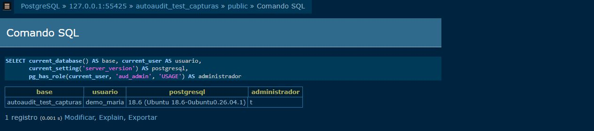

*Figura 1. Conexión real a `autoaudit_test_capturas` como `demo_maria`, PostgreSQL 18.6 y rol administrador.*

## 2. Configuración y triggers

Para iniciar una configuración, registrar la tabla, sus columnas y los eventos en `aud_tabla`, `aud_columna` y `aud_configuracion`, respectivamente. La tabla debe existir y tener llave primaria. El siguiente bloque es el patrón utilizado por la parte A de `08` para `cliente`:

```sql
INSERT INTO auditoria.aud_tabla (esquema, nombre_tabla)
VALUES ('public', 'cliente')
ON CONFLICT (esquema, nombre_tabla) DO NOTHING;

INSERT INTO auditoria.aud_columna (id_tabla, nombre_columna)
SELECT t.id_tabla, c.nombre
FROM auditoria.aud_tabla t
CROSS JOIN (VALUES ('nombre'), ('correo')) AS c(nombre)
WHERE t.esquema = 'public' AND t.nombre_tabla = 'cliente'
ON CONFLICT (id_tabla, nombre_columna) DO NOTHING;

INSERT INTO auditoria.aud_configuracion (id_columna, id_evento)
SELECT col.id_columna, e.id_evento
FROM auditoria.aud_columna col
JOIN auditoria.aud_tabla t USING (id_tabla)
CROSS JOIN auditoria.aud_evento e
WHERE t.esquema = 'public' AND t.nombre_tabla = 'cliente'
ON CONFLICT (id_columna, id_evento) DO NOTHING;
```

Este ejemplo activa los tres eventos para las columnas registradas de `cliente`. Para una selección distinta, filtrar explícitamente por nombre de columna y evento. La configuración por sí sola no instala el trigger: al final debe ejecutarse `generar_trigger`.

La configuración activa se consulta con:

```sql
SELECT t.esquema, t.nombre_tabla AS tabla, t.activa,
       count(*) FILTER (WHERE cf.activa) AS combinaciones_activas
FROM auditoria.aud_tabla t
JOIN auditoria.aud_columna c USING (id_tabla)
JOIN auditoria.aud_configuracion cf USING (id_columna)
GROUP BY t.id_tabla ORDER BY t.nombre_tabla;
```

En la demostración, `cliente` tiene 6 combinaciones y `producto` 4. Esos valores pertenecen a la base de demostración y no deben confundirse con las 7 y 4 combinaciones de las capturas aportadas de la GUI.

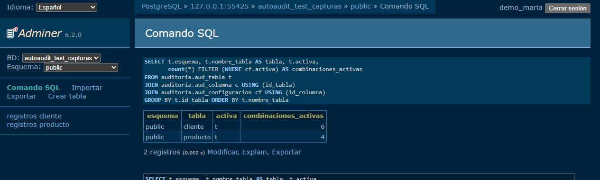

Para revisar triggers instalados:

```sql
SELECT c.relname AS tabla, t.tgname AS trigger, t.tgenabled AS habilitado
FROM pg_trigger t JOIN pg_class c ON c.oid = t.tgrelid
JOIN pg_namespace n ON n.oid = c.relnamespace
WHERE n.nspname = 'public' AND NOT t.tgisinternal
ORDER BY c.relname;
```

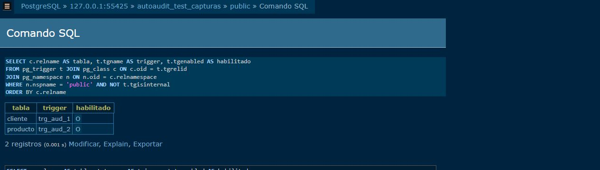

La generación o regeneración se realiza como `aud_admin`:

```sql
SELECT auditoria.generar_trigger(id_tabla)
FROM auditoria.aud_tabla
WHERE esquema = 'public' AND nombre_tabla = 'cliente';
```

Para retirar la auditoría de una tabla: `SELECT auditoria.eliminar_trigger(<id_tabla>);`. Después de cambiar columnas o eventos, volver a ejecutar `generar_trigger`.

## 3. Operaciones auditadas

La demostración insertó el registro `id_cliente = 5`, actualizó su correo y lo eliminó. El historial resultó en cinco eventos: INSERT de nombre y correo, UPDATE de correo y DELETE de nombre y correo.

Las instrucciones ejecutadas en la base de demostración fueron:

```sql
INSERT INTO public.cliente (nombre, correo, telefono)
VALUES ('Cliente Evidencia', 'evidencia@example.invalid', '0000')
RETURNING id_cliente;
UPDATE public.cliente SET correo = 'actualizado@example.invalid'
WHERE nombre = 'Cliente Evidencia';
DELETE FROM public.cliente WHERE nombre = 'Cliente Evidencia';
```

El ID 5 pertenece a esta ejecución. En otra base, usar el ID devuelto por INSERT. El dominio `example.invalid` y el nombre son datos ficticios de prueba.

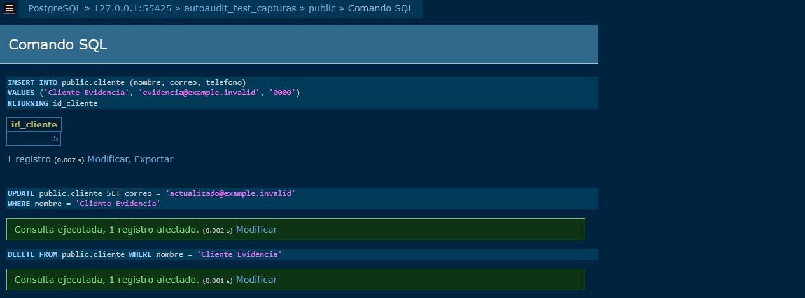

## 4. Consultar el historial

Por registro:

```sql
SELECT evento, columna, valor_anterior, valor_nuevo, usuario
FROM auditoria.historial_por_registro('public', 'cliente', '5')
ORDER BY id_bitacora;
```

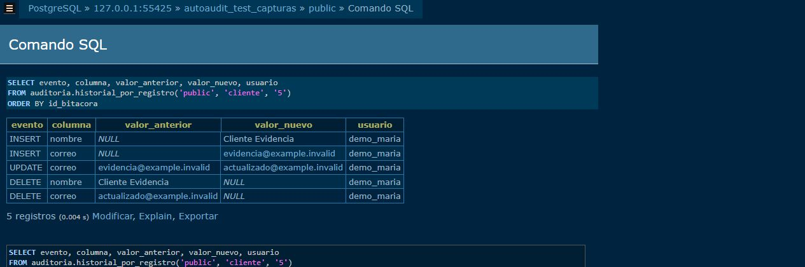

Por usuario:

```sql
SELECT usuario, tabla, columna, evento, valor_anterior, valor_nuevo
FROM auditoria.historial_por_usuario('demo_luis')
ORDER BY id_bitacora;
```

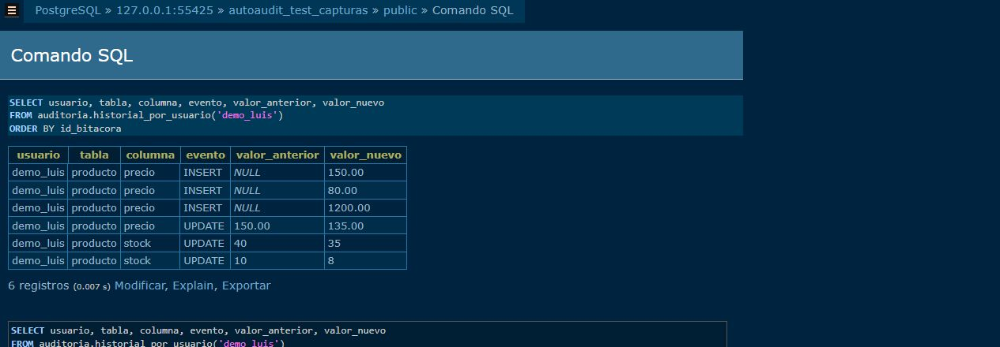

Por columna:

```sql
SELECT tabla, columna, evento, valor_anterior, valor_nuevo, usuario
FROM auditoria.historial_por_columna('public', 'producto', 'precio')
ORDER BY id_bitacora;
```

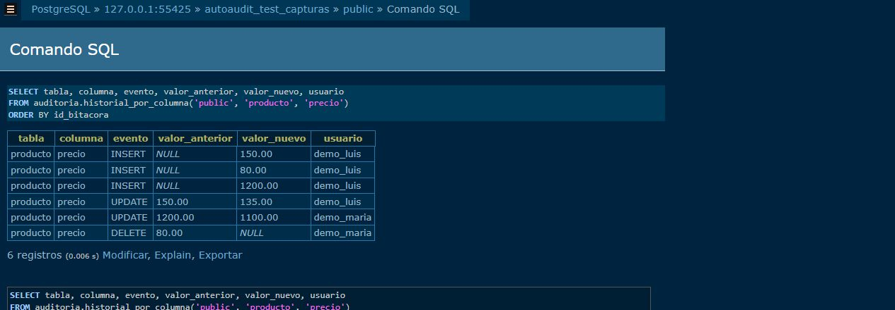

Para acotar por fecha, las funciones por usuario y columna aceptan `p_desde` y `p_hasta`. El inicio es inclusivo y el fin exclusivo; indicar zona horaria cuando se necesite comparar fechas locales con UTC.

```sql
SELECT * FROM auditoria.historial_por_usuario(
  'demo_maria',
  '2026-10-25 00:00:00-06'::timestamptz,
  '2026-10-26 00:00:00-06'::timestamptz
);
```

En Adminer, abrir **Comando SQL**, escribir la consulta y pulsar **Ejecutar**. Bajo el resultado, pulsar **Exportar**, seleccionar **guardar** y **CSV,**, y pulsar el botón **Exportar**. El archivo real de la demostración es `tests/resultados/20261025_capturas/historial_producto_precio.csv`.

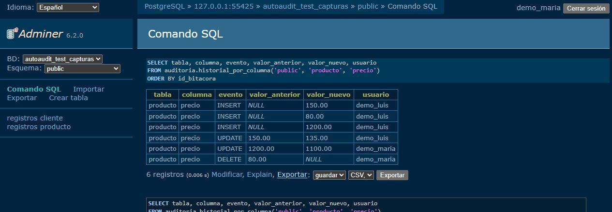

Alternativa en DBeaver: ejecutar la consulta, hacer clic derecho sobre la cuadrícula de resultados, elegir **Export data** y seleccionar CSV. No se debe guardar información real en el repositorio.

## 5. Origen y seguridad

La captura TCP realizada en este laboratorio registra `demo_maria`, aplicación `Adminer`, IP `172.17.0.1` y fecha UTC `2026-10-26 05:31:43` (25/10 en Guatemala). Es una demostración local con puente Docker y puerto restringido a `127.0.0.1:55425`; no representa todas las redes.

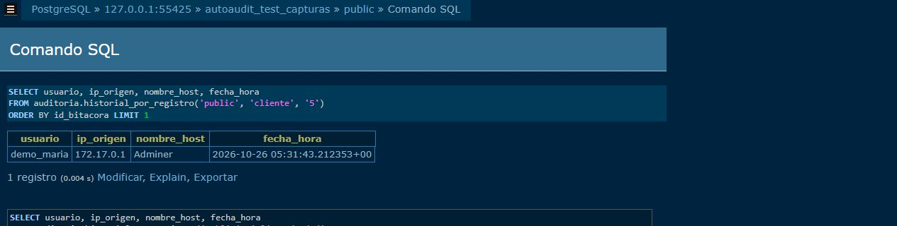

Los permisos sobre el esquema de auditoría se distribuyen así:

| Operación sobre auditoria | aud_admin | aud_consulta |
|---|---|---|
| Consultar vista y funciones del historial | Permitido | Permitido |
| Registrar y actualizar configuración | Permitido | Denegado |
| Generar y eliminar triggers | Permitido | Denegado |
| Leer o escribir directamente la bitácora | Denegado | Denegado |

En la captura, `demo_luis` consulta seis eventos mediante una función autorizada y recibe dos errores esperados al intentar leer la bitácora y generar un trigger. Su rol de consulta se refiere al esquema `auditoria`. Además hereda `demo_app`, que permite modificar las tablas de ejemplo; no es un usuario de solo lectura de toda la base.

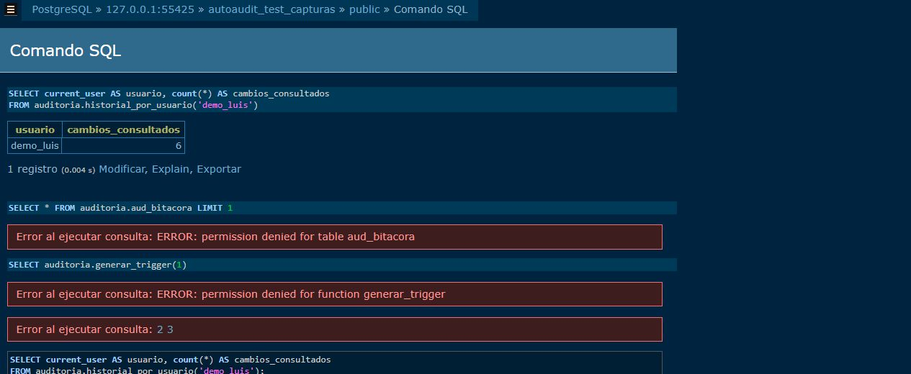

El dueño puede administrar la base; los triggers de protección bloquean UPDATE, DELETE y TRUNCATE sobre la bitácora dentro de las condiciones probadas. No se debe interpretar esto como una barrera frente a superusuarios.

## 6. Resultados y límites

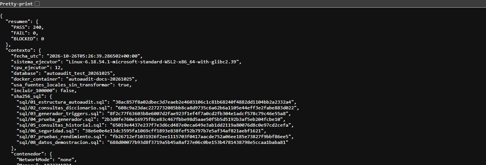

La suite integrada obtuvo 240 PASS, 0 FAIL y 0 BLOCKED. Este total incluye instalación, 29 comprobaciones funcionales, 49 de seguridad, 153 de rendimiento y tres de limpieza e integridad. No equivale a un porcentaje de cobertura.

Las operaciones que debían ser rechazadas cuentan como correctas solo al devolver el SQLSTATE esperado. Cada suite guarda mensajes `AA_RESULT` y `AA_SUMMARY`. Una salida distinta de cero del ejecutor indica fallos o bloqueos; deben revisarse `resultados.json` y los logs. Para repetir con Docker, usar las instrucciones de `tests/entorno/README.md`, crear una base nueva y añadir `--docker-container <nombre_del_contenedor>` al comando del ejecutor. El benchmark midió 100, 1.000 y 10.000 filas, tres repeticiones, con promedio, desviación, CV y sobrecosto. No se midió 100.000 ni se incluyó latencia de TCP.

## 7. Rendimiento observado

Los siguientes valores se calcularon a partir de las tres repeticiones guardadas por el ejecutor. DE es la desviación estándar muestral. El sobrecosto es el promedio de los porcentajes calculados por repetición con los tiempos publicados.

| Filas | Operación | Sin auditoría media ± DE ms | Con auditoría media ± DE ms | Sobrecosto medio |
|---:|---|---:|---:|---:|
| 100 | INSERT | 0,4 ± 0,2 | 6,6 ± 0,5 | 1.533,3 % |
| 100 | UPDATE | 0,4 ± 0,1 | 4,6 ± 1,0 | 1.266,7 % |
| 100 | DELETE | 0,1 ± 0,0 | 6,5 ± 0,9 | 6.366,7 % |
| 1.000 | INSERT | 2,4 ± 0,3 | 70,9 ± 16,1 | 2.900,5 % |
| 1.000 | UPDATE | 3,0 ± 0,2 | 40,3 ± 2,3 | 1.236,4 % |
| 1.000 | DELETE | 0,3 ± 0,1 | 62,8 ± 1,1 | 19.052,8 % |
| 10.000 | INSERT | 25,6 ± 8,0 | 675,3 ± 14,7 | 2.685,7 % |
| 10.000 | UPDATE | 30,5 ± 0,8 | 426,4 ± 4,3 | 1.298,5 % |
| 10.000 | DELETE | 3,4 ± 0,4 | 636,6 ± 3,8 | 18.564,6 % |

Se verificaron 2n eventos para INSERT, n para UPDATE y 2n para DELETE en cada repetición. La medición existente revierte sus datos y las comprobaciones de limpieza aprobaron. Las secuencias pueden avanzar aunque los datos se reviertan.

Estos tiempos se obtuvieron con 2 CPU, 1 GiB de RAM y tmpfs de 768 MiB, sin red. La función ejecuta primero sin auditoría y después con auditoría, por lo que orden y caché pueden influir. Redondea los tiempos a 0,1 ms: los porcentajes son especialmente inestables con duraciones muy pequeñas. Tres muestras no justifican extrapolar a producción ni afirmar crecimiento lineal. No se ejecutó el volumen de 100.000 registros.

## 8. Pantallas disponibles de la interfaz AutoAudit

El panel aportado muestra la sesión `demo_maria` con perfil administrador. La barra superior ofrece **Configuración**, **Consulta** y **Salir**. El resumen indica dos tablas activas y once combinaciones de columna y evento. Las tarjetas describen la configuración de auditoría y la consulta del historial.

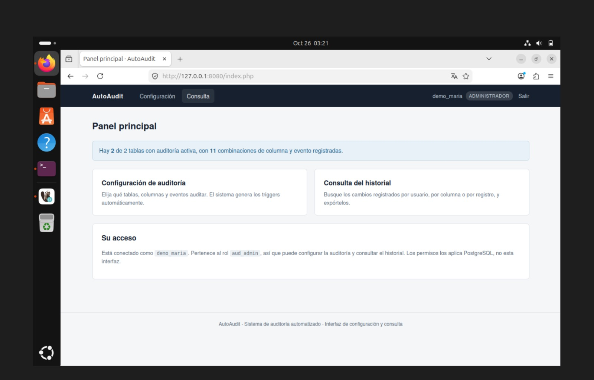

La pantalla de configuración aportada lista esquema, tabla, estado y cantidad de combinaciones activas. El botón **Configurar** aparece junto a cada tabla. No se dispone de una captura de su formulario de edición ni del resultado de guardar cambios.

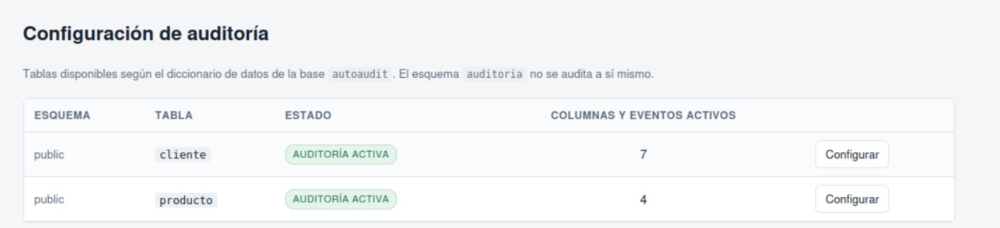

Las dos últimas imágenes muestran el panel de la GUI aportada: 11 combinaciones visibles (7 para `cliente` y 4 para `producto`). Difieren de la demostración SQL (6 y 4) y no comparten necesariamente la misma base. No se documentan aquí pasos de la pantalla Consulta porque no existe evidencia observada de su funcionamiento en este entorno.


## 9. Problemas frecuentes y revisión final

| Situación | Acción |
|---|---|
| El ejecutor rechaza una base existente | Crear otra base de pruebas vacía con el nombre permitido. |
| Error al instalar historial | Usar `05` de esta copia, que corrige la letra aislada anterior a RETURNS. |
| No aparecen eventos después de cambiar configuración | Comprobar columnas y eventos activos, regenerar el trigger y realizar una nueva operación. |
| Permiso denegado al configurar | Comprobar pertenencia a `aud_admin`; los permisos los aplica PostgreSQL. |
| Permiso denegado al leer la bitácora | Consultar `v_historial` o las funciones autorizadas. La denegación directa es esperada. |
| La IP aparece vacía | Una conexión por socket Unix puede devolver NULL; no inventar una dirección. |
| Uso del historial en la interfaz actual | Consulte GUIA_INTERFAZ.md; el módulo PHP ya está integrado y verificado. |

La interfaz PHP Sneat ya forma parte de esta integración. La guía visual final (`AutoAudit_Guia_Interfaz_Final.pdf`) documenta login, panel, configuración, consulta y exportación con capturas reales. La validación HTTP integrada obtuvo 37 PASS, 0 FAIL y 0 BLOCKED; la suite SQL09 obtuvo 35 PASS, 0 FAIL y 0 BLOCKED.

Las capturas finales de la interfaz están en `docs/capturas_interfaz/`. El log SQL09 y su resumen están en `tests/resultados/20261026_interfaz/`; las evidencias históricas de Adminer permanecen en `tests/resultados/20261025_capturas/` y no sustituyen la validación actual.

Documentación complementaria: `PRUEBAS_Y_RESULTADOS.md`, `MATRIZ_DE_PRUEBAS.md`, `RENDIMIENTO_METODOLOGIA.md`, `SEGURIDAD_Y_PRIVACIDAD.md` y `VALIDACION_ENTORNO.md`, en `docs/`. La ejecución guarda los hashes de las fuentes antes y después y comprueba que no cambien.

El trabajo queda en archivos locales para revisión. No se realizaron commits, push ni pull requests. Los archivos del generador y demostración proceden del commit `431451fede1b42e8ae56a3695878ab5f8a7f68ac`, sin modificaciones de contenido.
