# Guía de uso de AutoAudit

Esta guía explica la instalación local, el acceso por roles, la configuración de auditoría, las consultas del historial y la exportación CSV de la interfaz PHP con Sneat. Las imágenes referenciadas son capturas reales de la aplicación y no incluyen cursor.

## Instalación y preparación

Use una base de datos de laboratorio independiente. Requiere PHP 8.1 o posterior con `pdo_pgsql`, PostgreSQL y un servidor local. La validación se realizó con PHP 8.2.12 y PostgreSQL 18.6 en un contenedor Ubuntu 26.04; esto valida el userland y el software, no el kernel ni una máquina virtual Ubuntu.

Cargue `sql/01_estructura_autoaudit.sql`, `03_generador_triggers.sql`, `05_consultas_historial.sql`, `06_seguridad.sql` y `07_pruebas_rendimiento.sql` en ese orden como definiciones. Las invocaciones pesadas permanecen comentadas. Use `08_datos_demostracion.sql` solo para las demostraciones A y B; no ejecute la parte C completa, que incluye errores de permisos esperados. `09_interfaz.sql` es obligatorio para las funciones del diccionario que consume la interfaz; su parte B, que crea cuentas demo, es opcional y solo se usa en el laboratorio.

Configure `AUTOAUDIT_DB_HOST`, `AUTOAUDIT_DB_PORT`, `AUTOAUDIT_DB_NAME`, `AUTOAUDIT_APP_NAME` y `AUTOAUDIT_TIMEZONE`. El usuario y la contraseña se introducen en el inicio de sesión. La zona predeterminada es `America/Guatemala`. Inicie el servidor PHP apuntando a `app` y abra `login.php`.

Desde la raíz del proyecto, cree una base nueva y cargue las definiciones como propietario:

```powershell
createdb -U postgres autoaudit
psql -U postgres -d autoaudit -v ON_ERROR_STOP=1 -f sql/01_estructura_autoaudit.sql
psql -U postgres -d autoaudit -v ON_ERROR_STOP=1 -f sql/03_generador_triggers.sql
psql -U postgres -d autoaudit -v ON_ERROR_STOP=1 -f sql/05_consultas_historial.sql
psql -U postgres -d autoaudit -v ON_ERROR_STOP=1 -f sql/06_seguridad.sql
psql -U postgres -d autoaudit -v ON_ERROR_STOP=1 -f sql/07_pruebas_rendimiento.sql
```

Para reproducir las capturas, ejecute únicamente A y B de `08_datos_demostracion.sql` hasta FIN PARTE B; luego cargue `09_interfaz.sql` completo. La parte A de 09 instala funciones y permisos necesarios; la parte B habilita LOGIN en las cuentas demo de 08. Para cuentas propias, asigne `aud_admin` o `aud_consulta` a usuarios LOGIN y omita esa parte B.

```powershell
.\scripts\iniciar_interfaz.ps1 -DbName autoaudit -DbPort 5432 -Port 8080
```

Agregue `-PhpPath 'C:\ruta\php.exe'` si PHP no está en PATH. Abra `http://127.0.0.1:8080/login.php`. El lanzador usa solo loopback, no modifica la base de datos y elimina sus sesiones temporales al terminar. Las cuentas y contraseñas se escriben en el formulario, no en variables de entorno.

## Roles de demostración

| Cuenta | Rol | Acceso |
|---|---|---|
| `demo_maria` | `aud_admin` | Panel, configuración y consulta |
| `demo_luis` | `aud_consulta` | Panel y consulta |
| `demo_ana` | sin rol | Acceso rechazado |

Las contraseñas están en `sql/09_interfaz.sql` y no se imprimen en esta guía. Sustitúyalas en entornos reales.

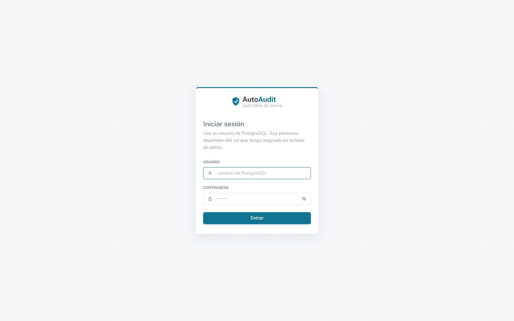

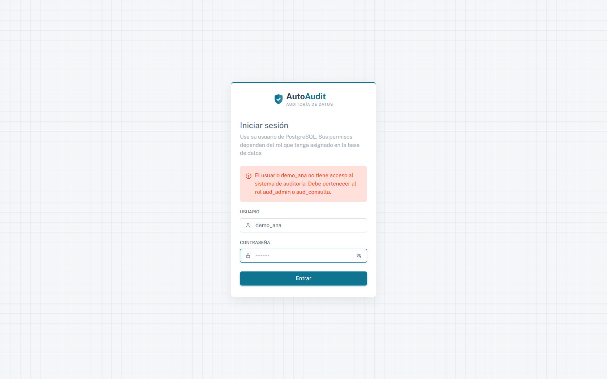

## Panel y configuración

Con `demo_maria`, el panel muestra 21 eventos, 2 tablas y 10 combinaciones activas: 6 para `cliente` y 4 para `producto`.

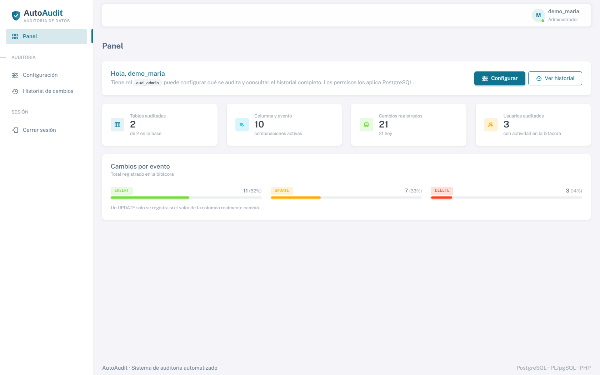

En Configuración seleccione una tabla, marque columnas y eventos `INSERT`, `UPDATE` o `DELETE`, y pulse Guardar. La aplicación regenera el trigger y muestra una confirmación. Las opciones de desactivar y reactivar permiten pausar y restablecer la auditoría. No audite el esquema `auditoria` ni tablas internas.

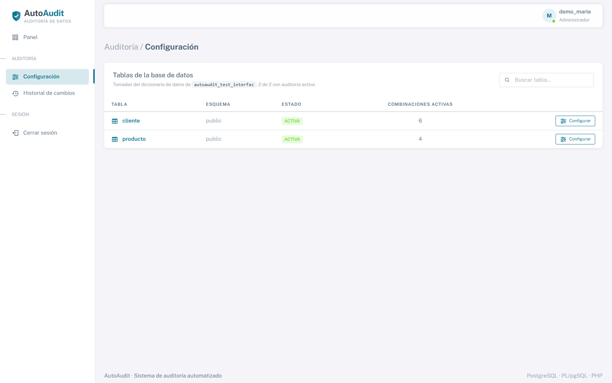

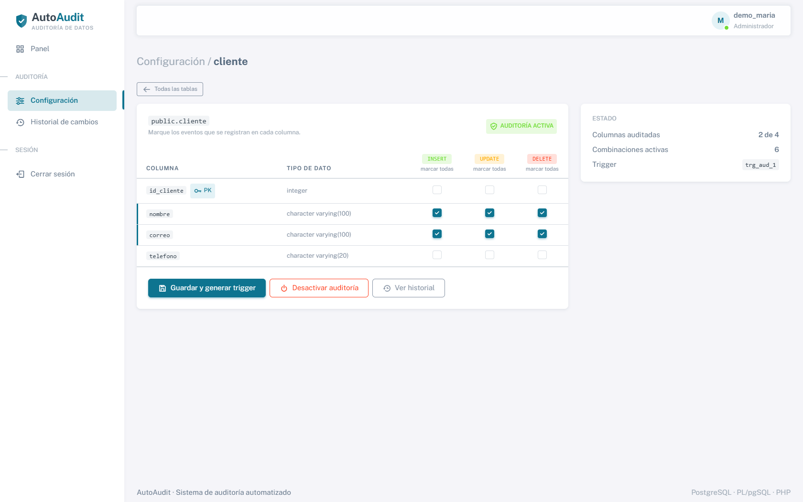

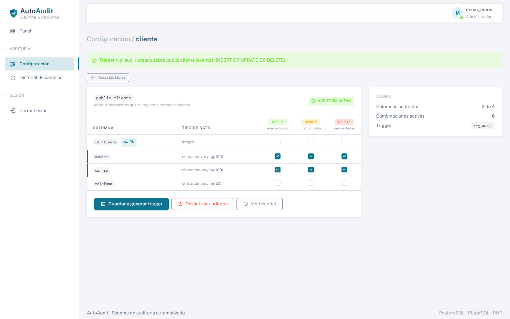

## Consulta del historial

Consulta combina usuario, tabla, columna, identificador, evento y fechas. Los filtros son parámetros preparados. Las fechas usan `America/Guatemala` y el límite superior es exclusivo. Ejemplos comprobados: `demo_luis` + `producto` + `precio` + `UPDATE` devuelve un evento (150 a 135); `cliente` con identificador 3 devuelve cuatro eventos; `producto.precio` entre 26/10/2026 00:00 y 27/10/2026 00:00 devuelve seis eventos.

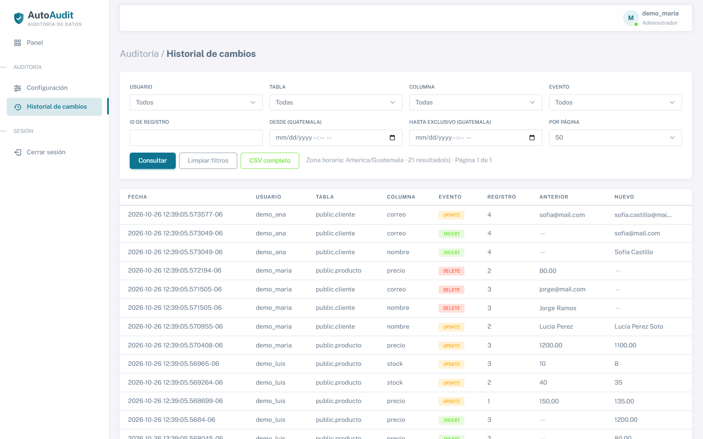

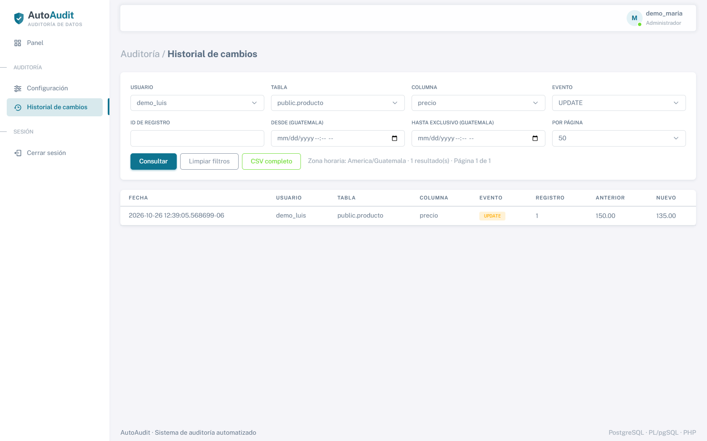

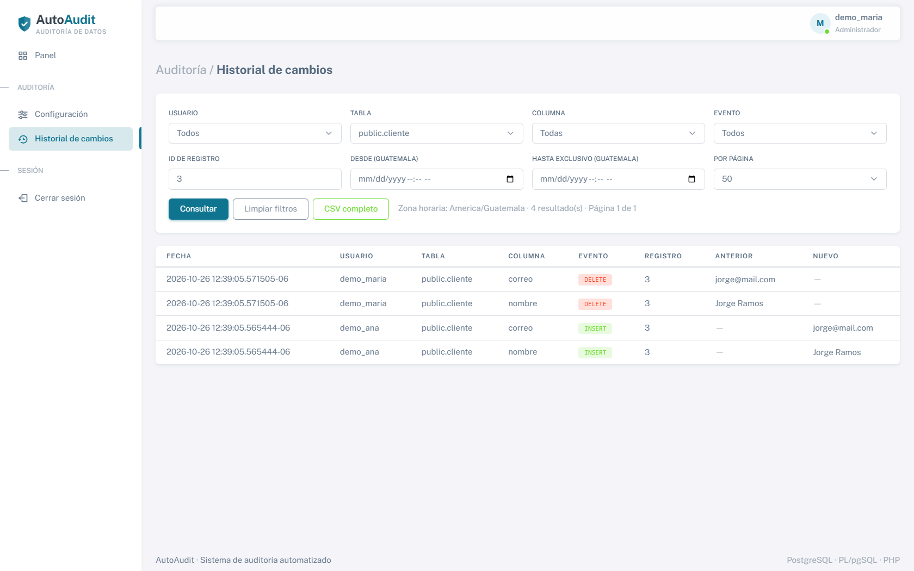

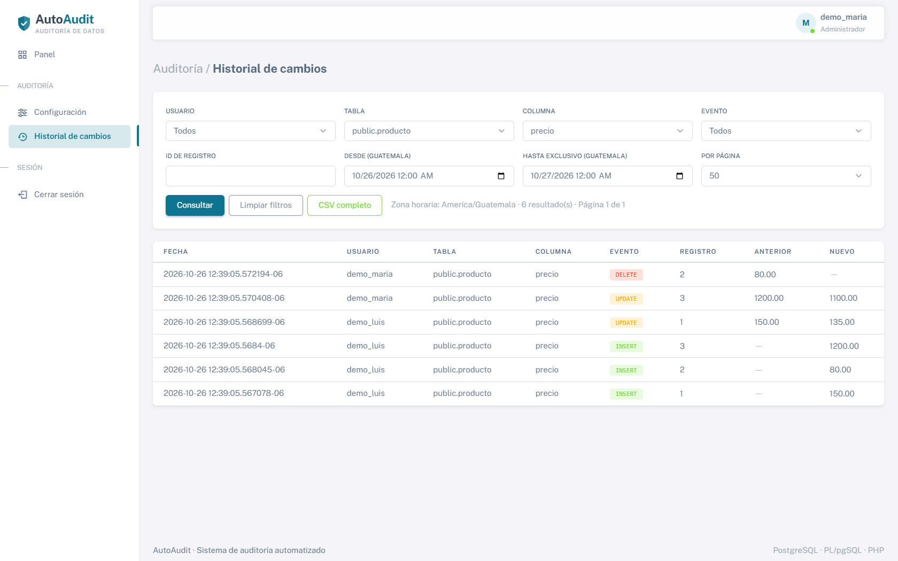

La paginación ofrece 25, 50 y 100 filas. CSV exporta todas las filas filtradas, no solo la página visible; usa BOM UTF-8, `\N` para NULL, neutraliza prefijos de fórmulas y conserva IP y aplicación.

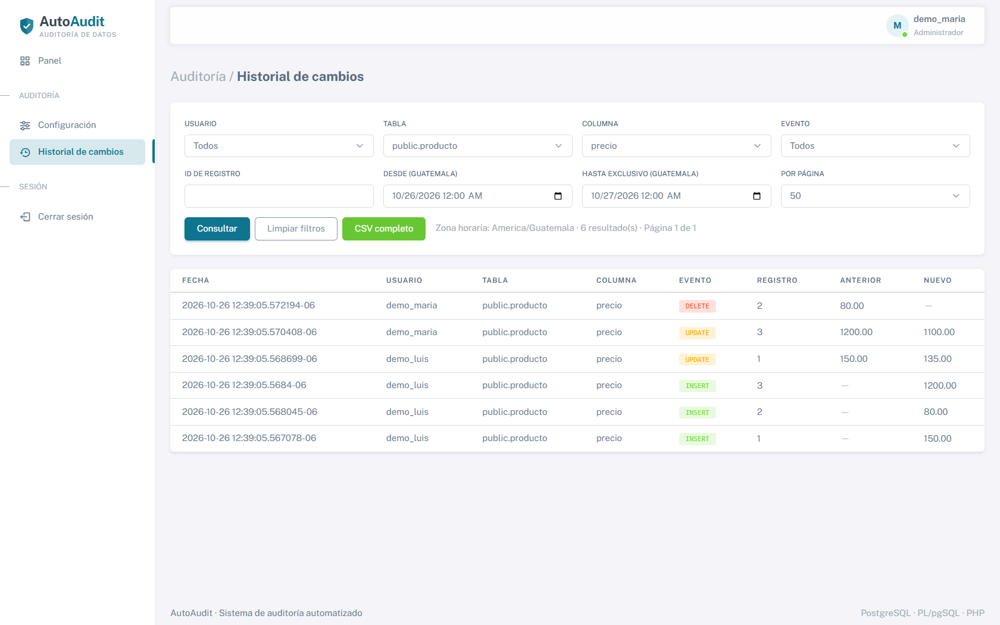

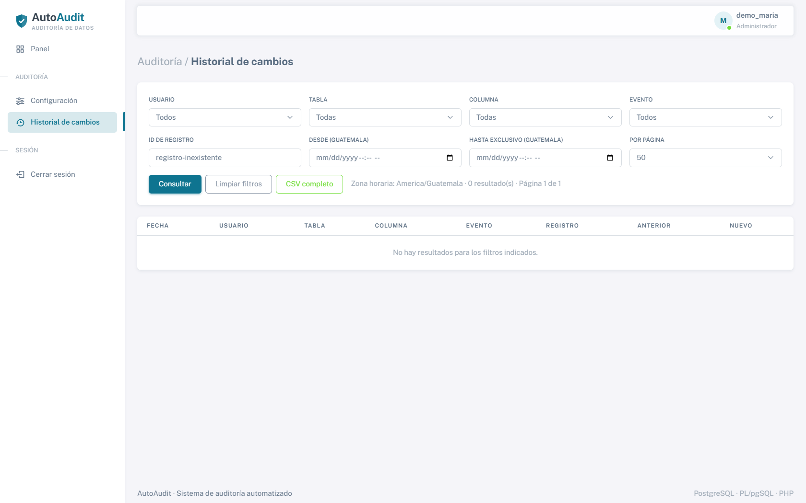

## Permisos y errores

`demo_luis` puede consultar historial de otros usuarios, pero recibe 403 en Configuración. `demo_ana` no entra. Use **Cerrar sesión** al terminar.

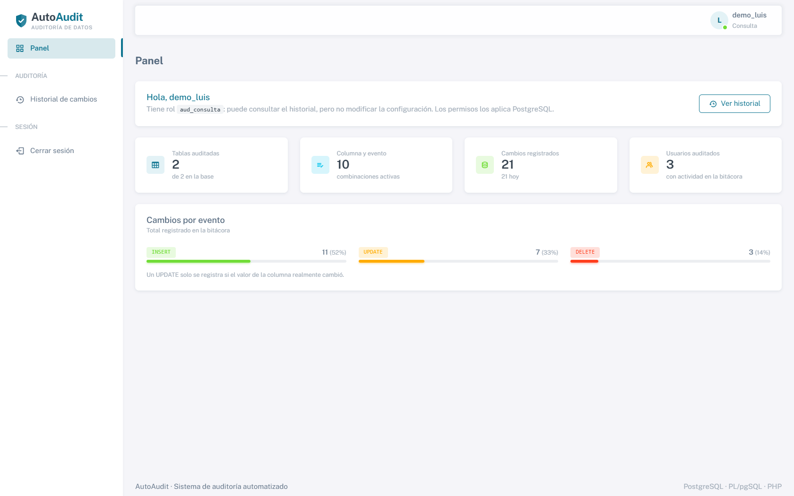

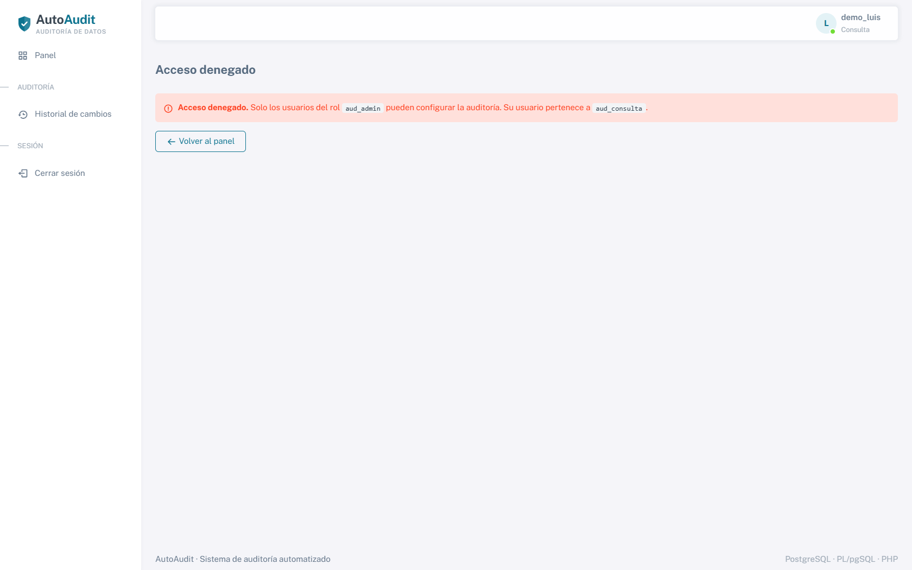

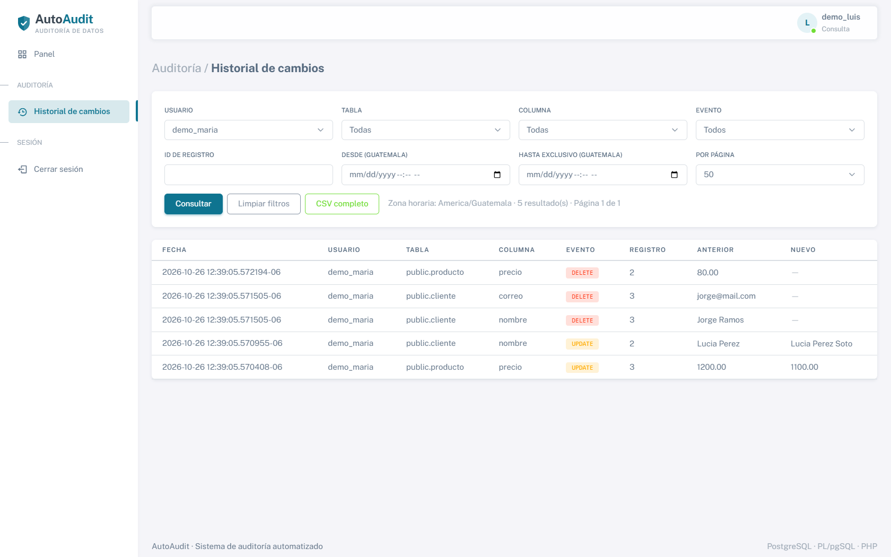

Si no conecta, revise variables y `pdo_pgsql`; si aparece 403, revise el rol; si no hay tablas, cargue el diccionario; si el CSV está vacío, revise filtros y fecha; si falta una columna, actualice la tabla seleccionada.

## Pruebas y fuentes

El backend controlado obtuvo 240 PASS, SQL09 obtuvo 35 PASS e integración HTTP obtuvo 38 PASS. El navegador aprobó 29 comprobaciones, incluidas navegación desde configuración, desactivación y reactivación, y produjo las 15 capturas reales. Un diagnóstico anterior de 236 PASS y 4 fallos con duraciones negativas cercanas a -9.5 s se conserva como diagnóstico excluido; no se atribuye su causa a límites de CPU. El benchmark usó 3 repeticiones para 100, 1 000 y 10 000 filas; 100 000 no se ejecutó y la variabilidad fue alta, por lo que no se extrapola a producción.

Fuentes: `sql/01_estructura_autoaudit.sql`, `03_generador_triggers.sql`, `05_consultas_historial.sql`, `06_seguridad.sql`, `07_pruebas_rendimiento.sql`, `08_datos_demostracion.sql`, `09_interfaz.sql`, `tests/` y `docs/capturas_interfaz/`. Los documentos antiguos centrados en SQL son históricos; esta guía es la referencia principal de la interfaz.

La evidencia final está en `tests/resultados/20261026_backend_controlado/`, `20261026_interfaz/` y `20261026_http_verificado/`. Las capturas se obtuvieron el 26/10/2026 con Chrome, a 1680 × 1050, de la aplicación PHP real servida en loopback; los SHA256 están en `capturas_manifest.json`.
